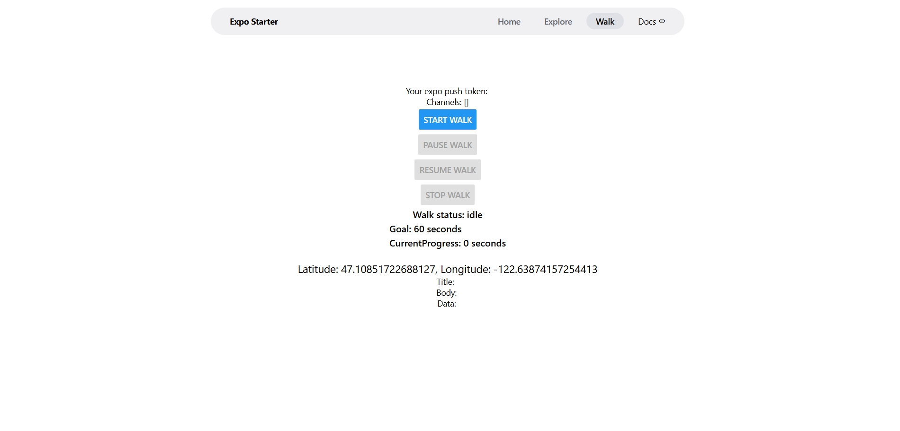
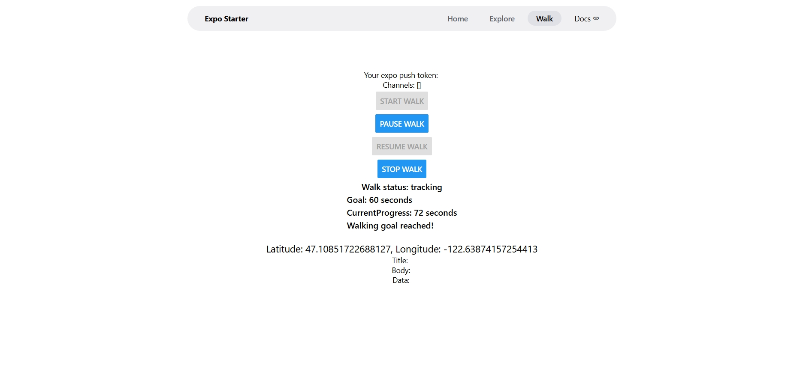

# Walking Tracker

A mobile walking tracker built with Expo and React Native. Check your current location, record a walk, and review its saved location points. Added pause reminders and notificatiosn when reaches a walking goal.

## Features

- View your current latitude and longitude.
- Start, pause, resume, and stop location tracking.
- See the current tracking status: idle, tracking, or paused.
- Review recorded location points.
- Receive location updates in the background on mobile while a walk is active.
- Request permission to display notifications
- Pausing timer to remind
- Walking goal of 60 seconds with a notification once you walked for 60 seconds

## Get Started

### Requirements

- Node.js and npm
- A device or emulator with location services enabled

### Install and Run

```bash
npm install
npx expo start
```

Open the app in Expo Go or an emulator. Use the Expo CLI prompts to select a platform.

## Using the Tracker

1. Select **Get Current Location** to view your coordinates.
2. Select **Start Walk** and grant the requested location permissions.
3. Use **Pause** and **Resume** to control tracking during your walk.
4. Select **Stop** to finish. Recorded points appear in the list.

> Location access requires foreground permission. Android and iOS also request background location permission when you start a walk.

## Manual Checks

- **Current location:** Allow permission and confirm that coordinates appear. Denying permission should show an error message.
- **Walk tracking:** Start a walk, move with the device, and confirm that location points are recorded.
- **Tracking controls:** Pause, resume, and stop the walk using the corresponding buttons.

## Built With

- [Expo](https://expo.dev/)
- [React Native](https://reactnative.dev/)
- `expo-location`
- `expo-task-manager`

## Privacy

The app reads your location when you request your current position. During an active walk, it records latitude, longitude, and timestamps. Recorded points are stored locally on the device. Pause or stop tracking to end location collection for the walk.

## Edit 10/26/26 Testing Newly Added Timers and Goal Notifications
1. Approve notification permission and confirm that the status message changes.
Yes. I have approved permission on mobile device. Remembers permissions.
2. Deny notification permission and confirm that the app explains that reminders are disabled.
Yes. I have declined permission on web. 
3. Pause a walk and wait for the reminder to appear.
This works.
4. Pause and then resume the walk before the reminder appears.
I didn't get notification. Counted 9 seconds before resuming. 
5. Confirm that the reminder does not appear after the walk is resumed.
Does appear. Fixing after this is documented.
6. Pause and then stop the walk before the reminder appears.
Yup.
7. Confirm that the reminder does not appear after the walk is stopped.
Does appear. Fixing after this is documented.
8. Complete the 60-second walking goal.
Completed.
9. Confirm that the goal notification appears.
Yes, it does.
10. Confirm that the goal notification appears only once during the walking session.
Yes, it does.
11. Minimize the app and confirm that a notification can still appear.
Yes, it does.

# PRoject Working




## Greatest Problems/Challenges
The biggest challenge so far was adding the simple walking goal. When I looked it up and 
started researching on how I can do this, the code made little sense to me so I had to
go down a rabbit hole on things like what ReturnType<typeof setInterval>  is. At first, I was overwhelmed because I didn't know where to start but then it started to make more sense
once I started reading the code because I've worked with it in the past.


The second biggest challenge was how can I make an ID for the pause reminder? Luckily, after looking it up, it was straight forward. Had to make a key, which can be translated into an ID
(learned this from HashTable). Then the rest started to make more sense and I was understanding.

The third biggest challenge was that Expo Go App decided to update to SDK version 58.0.0
while my VsCode was still on 57.0.0 so I was getting annoyed as to why my code suddenly
stopped working or was showing red lines. Thats when I asked AI to help me solve the issue, and it did.