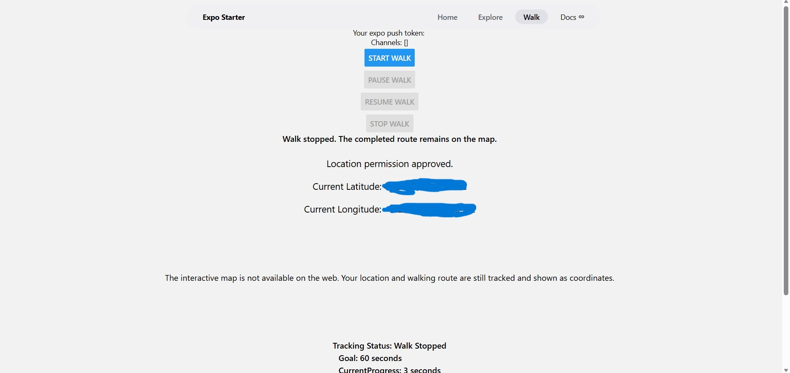
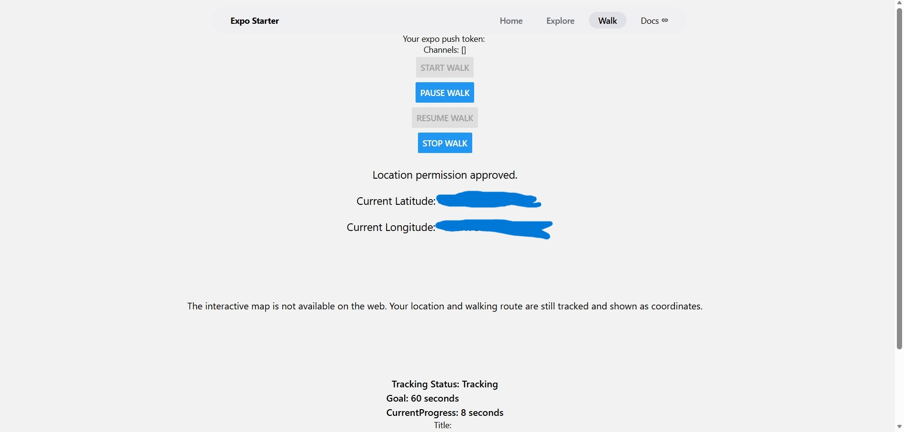

# Walking Tracker

A mobile walking tracker built with Expo and React Native. Check your current location, record a walk, and review its saved location points. Added pause reminders and notifications when reaches a walking goal.

## Features

- View your current latitude and longitude.
- Start, pause, resume, and stop location tracking.
- See the current tracking status: idle, tracking, or paused.
- Review recorded location points.
- Receive location updates in the background on mobile while a walk is active.
- Request permission to display notifications
- Pausing timer to remind
- Walking goal of 60 seconds with a notification once you walked for 60 seconds
- 

## Get Started

### Requirements

- Node.js and npm
- A device or emulator with location services enabled

### Install and Run

```bash
npm install
npx expo start
```

Open the app in Expo Go or an emulator. Use the Expo CLI prompts to select a platform.

## Using the Tracker
## Testing Location Changes

- **Physical device:** Start a walk and physically move. `watchPositionAsync` with
  balanced accuracy fires on significant movement, so walk around the block rather
  than pacing in one room.
- **Android Emulator:** ⋮ (Extended controls) → Location → set or route coordinates.
- **iOS Simulator:** Features → Location → Custom Location or a simulated route.
- Each new location becomes a route point; the route line appears after at least
  two points are recorded.

> Location access requires foreground permission. Android and iOS also request background location permission when you start a walk.

## Using on Mobile

1. Download Expo Go App and sign in with the same email you used for GitHub/VsCode.
2. Make sure your mobile device and the enviornment(computer used to run this program) you used to set up is connected to the same wifi.
3. Run npx expo start in terminal.
4. Scroll until you see the QR code, scan it with your phone camera, and viola! App
   should be running on your phone.

## Manual Checks

- **Current location:** Allow permission and confirm that coordinates appear. Denying permission should show an error message.
- **Walk tracking:** Start a walk, move with the device, and confirm that location points are recorded.
- **Tracking controls:** Pause, resume, and stop the walk using the corresponding buttons.

## Built With

- [Expo](https://expo.dev/)
- [React Native](https://reactnative.dev/)
- `expo-location`
- `expo-task-manager`
- `expo-linking`
-`react-native-maps expo-location`

## Privacy

The app reads your location when you request your current position. During an active walk, it records latitude, longitude, and timestamps. Recorded points are stored locally on the device. Pause or stop tracking to end location collection for the walk.

# Edit 10/26/26 Testing Newly Added Timers and Goal Notifications

1. Approve notification permission and confirm that the status message changes.
   Yes. I have approved permission on mobile device. Remembers permissions.
2. Deny notification permission and confirm that the app explains that reminders are disabled.
   Yes. I have declined permission on web.
3. Pause a walk and wait for the reminder to appear.
   This works.
4. Pause and then resume the walk before the reminder appears.
   I didn't get notification. Counted 9 seconds before resuming.
5. Confirm that the reminder does not appear after the walk is resumed.
   Yes.
6. Pause and then stop the walk before the reminder appears.
   Yup.
7. Confirm that the reminder does not appear after the walk is stopped.
   Yes.
8. Complete the 60-second walking goal.
   Completed.
9. Confirm that the goal notification appears.
   Yes, it does.
10. Confirm that the goal notification appears only once during the walking session.
    Yes, it does.
11. Minimize the app and confirm that a notification can still appear.
    Yes, it does.

# Project Working


## Greatest Problems/Challenges

The biggest challenge so far was adding the simple walking goal. When I looked it up and
started researching on how I can do this, the code made little sense to me so I had to
go down a rabbit hole on things like what ReturnType<typeof setInterval> is. At first, I was overwhelmed because I didn't know where to start but then it started to make more sense
once I started reading the code because I've worked with it in the past.

The second biggest challenge was how can I make an ID for the pause reminder? Luckily, after looking it up, it was straight forward. Had to make a key, which can be translated into an ID
(learned this from HashTable). Then the rest started to make more sense and I was understanding.

The third biggest challenge was that Expo Go App decided to update to SDK version 58.0.0
while my VsCode was still on 57.0.0 so I was getting annoyed as to why my code suddenly
stopped working or was showing red lines. Thats when I asked AI to help me solve the issue, and it did.


# 11/5/26 Deep Links

## Schemes
Computer(web):http://localhost:8081/walk/1
iPhone: mywalks://walk/1
Android: walkingtracker://walk/1
Expo Go: exp://10.0.0.200:8081/--/walk/1

## Valid Deep Link Example

```
mywalks://walk/1
```

Opens the app to the Walk Details screen for walk 1 (October 1, 2026 at 10:00 AM,
47.6062, -122.3321, Completed).

## Invalid Deep Link Examples

```
mywalks://walk/999     → Walk not found. Please check the walk ID.
mywalks://walk/        → A walk ID is required.
mywalks://banana       → This link cannot be opened by the Mobile Walking Tracker.
```

## How to Test the Deep Link

- **Web:** run `npx expo start`, then open `http://localhost:8081/walk/1` in a browser.
- **Expo Go (iPhone):** run `npx expo start --tunnel`, then put
  `exp://<tunnel-url>/--/walk/1` in the Notes app and tap it (Safari blocks typed
  custom schemes, and Expo Go only registers the `exp://` scheme).
- **Standalone build:** `mywalks://walk/1` works once the app is installed as a
  development build (EAS Build), which registers the custom scheme with iOS.

## Deep Links Situations
1. A valid deep link opens the correct saved walk.
Yes, this works. This is what handleDeepLink() does in src/components/WalkDetailsScreen.tsx.
2. A deep link works while the app is already open.
Yes, this works. This is what Linking.addEventListener() does in src/app/_layout.tsx.
3. A deep link works while the app is running in the background.
Yes, this works.
4. A deep link works when the app is completely closed.
Yes, this works. This is what Linking.getInitialURL() does in src/app/_layout.tsx.
5. A deep link with an invalid walk ID is handled safely.
Yes, this works. This is what if (!walk) {} is used for in src/app/walk/[id].tsx
6. A deep link with a missing walk ID is handled safely.
Yes, this works. This is what if (Platform.OS === "web" && window.location.pathname.endsWith("/walk/")) {
      setLinkError("A walk ID is required.");
    } in src/app/walk/index.tsx is for.
7. The Maps button uses the selected walk's coordinates.
Yes, this works. This is what openMaps = async () =>{} is used for in src/components/WalkDetailsScreen.tsx.
8. The web map button uses the selected walk's coordinates.
Yes, this works. This is what  openWebLocation = async () =>{}is used for in src/components/WalkDetailsScreen.tsx.
9. The app displays an error message when an action cannot be opened.
Yes, this works.
10. The app continues running after an external action fails.
Yes, this works. This is used for the Maps, the OpenStreetMap and handleDeepLink as to not
crash the app.

## Problems Encountered

1. **First adding the deep link** After completed steps 1-5, I was stumped on step 6. I didn't know what to do, so I looked on Google and asked CoPilot for help. Luckily, they were both able to help and from starting the project all the way to the end, it was making sense.
2. **/walk/2 kept closing and redirecting to the Home tab.** At first, whenever I tried out http://localhost:8081/walk/2, it automatically closed itself out. What I found out was that the tab navigator only recognizes its own tabs, so /walk/2 had nowhere to render. AI was able to fix it by turning the walk tab into a stack (walk/_layout.tsx) with the tracker as index and [id].tsx pushing on top.


# 11/8/26
Test the following situations and document the results in your README:

1. Approve location permission.
✔
2. Confirm that the permission-approved message appears.
✔
3. Deny location permission.
✔
4. Confirm that the permission-denied message appears.
✔
5. Confirm that the app continues running after permission is denied.
✔
6. Confirm that the current location appears on the map.
✔
7. Confirm that the destination marker appears. (optional)
🗙 optional
8. Confirm that the destination circle appears. (optional)
🗙 optional
9. Confirm that the destination name and radius appear. (optional)
🗙 optional
10. Start a walk and change the device's location.
✔
11. Confirm that new route points are recorded.
✔
12. Confirm that a route line appears after multiple points are recorded.
✔
13. Stop the walk.
✔
14. Confirm that no new route points are added after stopping.
✔
15. Confirm that the completed route remains visible.
✔
16. Move from outside the destination area to inside the area. (optional)
🗙 optional
17. Confirm that one Entered event is created. (optional)
🗙 optional
18. Remain inside the destination area. (optional)
🗙 optional
19. Confirm that duplicate Entered events are not created. (optional)
🗙 optional
20. Move from inside the destination area to outside the area. (optional)
🗙 optional
21. Confirm that one Exited event is created. (optional)
🗙 optional
22. Remain outside the destination area. (optional)
🗙 optional
23. Confirm that duplicate Exited events are not created. (optional)
🗙 optional
24. Confirm that the event log includes dates and times. (optional)
🗙 optional
25. Confirm that the app does not crash if location data is unavailable.
✔

## Map and Destination Features

The Walk Map screen displays an interactive map (react-native-maps) centered on the
user's current location with a "You are here" marker. While a walk is being tracked,
the app records each new location as a route point and draws the walked route on the
map as a polyline. The completed route stays visible after the walk is stopped.

The destination feature (destination marker, geofence circle, and Entered/Exited
event log) was implemented as optional extra credit work.

- **Selected destination:** Tacoma Dome
- **Destination radius:** 100 meters
- **How the coordinates were selected:** The Tacoma Dome (47.2367, -122.4275) is a
  well-known public landmark near my testing location, chosen instead of a private
  residential address. The 100-meter radius was chosen to make enter/exit testing
  easy on foot; a larger radius can be used for emulator testing.


## Problems Encountered

1. **Map crashed on web** — `react-native-maps` is native-only and crashed the web
   build with `codegenNativeComponent is not a function`. Fixed by adding a
   platform-specific `walk-map.web.tsx` fallback, which Metro automatically picks
   for web builds.
2. **Permission prompt never appeared on Expo Go** — the OS had saved my earlier
   denial, so `requestForegroundPermissionsAsync` silently returned the old status.
   Fixed by resetting Expo Go's location permission in the phone settings, and by
   re-checking the permission every time the screen gains focus (`useFocusEffect`)
   since tab screens stay mounted.
3. **"Cannot find native module 'ExpoAsset'" crash** — a stale copy of old tracking
   code (`walk.ts`) had been left inside the `app/` routes folder, and Expo Router
   tried to load it as a screen at startup. Deleting the stray file fixed the crash.
4. **Metro "unknown module" errors after adding files** — caused by Metro's cached
   module graph. Fixed by restarting with `npx expo start --clear`.

## Screenshots



